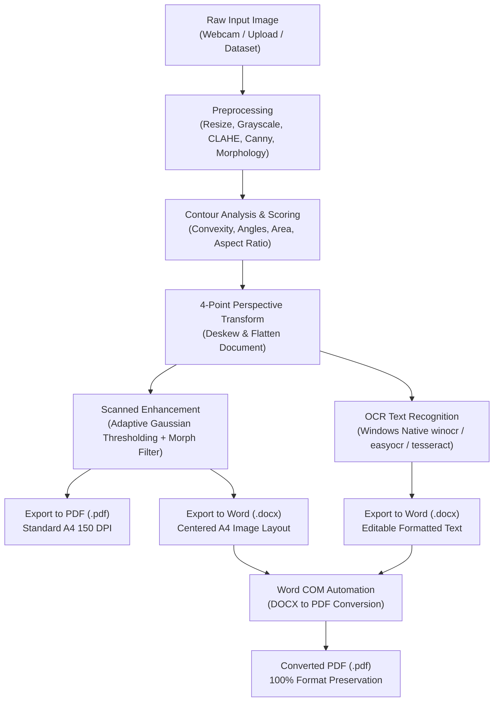

# Document Scanner & Converter Studio

A high-performance document scanning, perspective rectification, OCR extraction, and format conversion system built with Python, OpenCV, and Streamlit.

This project transforms mobile camera captures, webcam frames, or uploaded document images into clean, flat, high-contrast digital scans. It features automatic 4-corner document detection, perspective deskewing, binarization, optical character recognition (OCR), and direct multi-format export to **PDF (.pdf)** and **Microsoft Word (.docx)**. It also includes an integrated **1-click Word-to-PDF converter** powered by native Microsoft Word COM automation.

---

## 🌟 Key Features

- **Automated Page Boundary Detection**: Multi-metric quadrilateral scoring evaluating candidate contours by area, convexity, corner angles ($60^\circ - 120^\circ$), aspect ratio penalties, and border proximity.
- **Perspective Deskewing & Rectification**: 4-point perspective warp transformation that automatically calculates optimal document dimensions and straightens tilted or angled shots.
- **Scanned Image Enhancement**: Adaptive Gaussian thresholding and two-stage morphological filtering (Opening + Closing) to remove background shadows, clean noise, and enhance ink strokes.
- **Direct Camera Capture**:
  - Web UI: Real-time photo capture using Streamlit (`st.camera_input`).
  - CLI: High-resolution live webcam preview with Space-to-capture (`scripts/capture_scan.py`).
- **Dual Export Formats**:
  - **Standardized PDF (.pdf)**: High-resolution A4 document layout ready for printing or archiving.
  - **Word (.docx) - Scanned Layout**: Scanned pages embedded into A4 formatted Word documents with standard margins.
  - **Word (.docx) - OCR Editable Text**: Optical character recognition extracts text directly into editable Word paragraphs.
- **1-Click DOCX to PDF Converter**: Native Microsoft Word COM automation on Windows to convert any `.docx` file to `.pdf` while preserving 100% of fonts, layouts, and formatting.
- **Interactive Web UI**: Streamlit-powered dashboard offering dual operating modes, side-by-side visual comparisons, parameter sliders, OCR preview, and 1-click downloads.
- **1-Click Windows Launcher**: Convenient `run_app.bat` script for launching the application directly in your default browser.

---

## 🏗️ System Architecture & Pipeline



---

## 📁 Project Structure

```
document-scanner/
├── app.py                      # Streamlit interactive Web UI application
├── run_app.bat                 # Windows 1-click launcher script
├── requirements.txt            # Python package dependencies
├── README.md                   # Project documentation & user guide
├── documents/
│   └── raw/                    # Test images & GNHK sample dataset
│       ├── base.jpg
│       ├── diagonal_view.jpg
│       ├── GNHK_fail.jpg
│       ├── GNHK_success.jpg
│       └── redlight.jpg
├── outputs/                    # Default destination for scanned files and logs
│   ├── .gitkeep
│   └── reference/
│       └── debug/              # Benchmark evaluation logs and debug visual artifacts
│           └── eval/
│               ├── detection_log.csv
│               ├── debug_all/
│               └── multi_scan/
├── scripts/                    # Command-line interface (CLI) execution scripts
│   ├── __init__.py
│   ├── capture_scan.py         # Live webcam capture & document scanner
│   ├── convert_docx_to_pdf.py  # Standalone DOCX to PDF COM converter
│   ├── multi_img_test.py       # Batch evaluation across directories with metrics
│   ├── ocr_test.py             # OCR text extraction and editable DOCX generator
│   └── single_img_test.py      # Single-image scanner with PDF/DOCX export
└── src/                        # Core algorithms and helper modules
    ├── __init__.py
    ├── camera.py               # Webcam device handler with OpenCV preview
    ├── converter.py            # Windows Microsoft Word COM automation converter
    ├── detect_page.py          # Contour detection, candidate scoring & point ordering
    ├── export.py               # Multi-image PDF and Word DOCX exporter
    ├── io_handling.py          # File I/O, image loading, and directory utilities
    ├── ocr_engine.py           # Multi-engine OCR recognizer and DOCX formatter
    ├── preprocess.py           # Dimension normalization, grayscale, CLAHE, edges
    ├── thresholding.py         # Adaptive thresholding and morphological cleanup
    └── transform.py            # 4-point perspective warp and homography deskewing
```

---

## ⚙️ Installation & Requirements

### System Requirements
- **Operating System**: Windows 10 / 11 (recommended for native Windows OCR & Word COM automation).
- **Python**: Python 3.10+ or Python 3.11+.
- **Microsoft Office Word**: Required for native `.docx` to `.pdf` COM conversion.
- **Webcam / Camera**: Optional, required only for live photo capture features.

### Setup Instructions

1. **Clone the repository:**
   ```bash
   git clone https://github.com/Vietcute0210/document-scanner.git
   cd document-scanner
   ```

2. **Create and activate a virtual environment (recommended):**
   ```bash
   python -m venv .venv
   .venv\Scripts\activate
   ```

3. **Install dependencies:**
   ```bash
   pip install -r requirements.txt
   ```

---

## 🚀 Quick Start (Web UI)

### Option 1: 1-Click Launch (Windows)
Double-click `run_app.bat` in the project root directory. The launcher will automatically start Streamlit and open the application in your default web browser.

### Option 2: Command Line Launch
Run the following command from the project root:
```bash
streamlit run app.py
```
Then navigate to `http://localhost:8501` in your browser.

---

## 🖥️ Web UI Walkthrough

The Streamlit interface provides two major operational modes accessible from the sidebar:

### 1. Document Scanner & Exporter (`Quét & Xuất Tài Liệu`)
- **Three Input Methods**:
  - **Camera Tab**: Capture live snapshots using your connected webcam.
  - **Upload Tab**: Drag and drop existing images (`.jpg`, `.jpeg`, `.png`, `.webp`, `.bmp`).
  - **Sample Tab**: Choose from bundled test images in `documents/raw/`.
- **Customizable Processing Settings**:
  - **CLAHE Toggle**: Balances uneven illumination and reduces harsh shadows.
  - **Resolution Slider**: Adjusts detection resizing (`max_dim` from 600px to 2000px).
  - **Output Style**: Switch between high-contrast black-and-white scan (`B&W`) or flattened full-color image.
  - **OCR Language**: Select recognition language between English (`en`) and Vietnamese (`vi`).
- **Visual Inspection**:
  - **Left Column**: Original image overlaid with detected green polygon boundaries and red corner markers, along with detection method and confidence score.
  - **Right Column**: Rectified, deskewed, and binarized document preview.
- **Direct Downloads**:
  - 📄 **Tải File PDF (.pdf)**: Download high-resolution standardized A4 PDF.
  - 📝 **Tải File Word (.docx) - Bản Scan**: Download Word document with embedded scanned page layout.
  - 🔍 **Trích Xuất Chữ (OCR) Ra Word**: Run OCR recognition, preview extracted text directly in an expandable text box, and download an editable `.docx` document.

### 2. Word to PDF Converter (`Chuyển Đổi DOCX sang PDF`)
- Upload any Microsoft Word `.docx` file.
- Click **Bắt Đầu Chuyển Đổi Sang PDF** to invoke Microsoft Word COM automation in the background.
- Download the generated `.pdf` file with 100% preservation of fonts, page geometry, and styles.

---

## 💻 Command Line Interface (CLI) Guide

All core capabilities are available through modular CLI scripts:

### 1. Single Image Scan & Multi-Format Export
Scan a single document image, detect boundaries, deskew, and export to image, PDF, and Word:
```bash
python -m scripts.single_img_test --img documents/raw/base.jpg --outdir outputs/my_scan --pdf --docx
```
- `--img`: Path to input image *(required)*.
- `--outdir`: Destination directory for debug and output files *(default: outputs/debug/run_one)*.
- `--max-dim`: Maximum dimension for edge detection *(default: 1200)*.
- `--clahe`: Enable CLAHE contrast balance for shadowed documents.
- `--pdf`: Generate `scanned_doc.pdf`.
- `--docx`: Generate `scanned_doc.docx`.

### 2. Live Webcam Capture & Scan
Open a live camera feed with an instructional overlay. Press `SPACE` to capture a frame and execute the scanning pipeline:
```bash
python -m scripts.capture_scan --outdir outputs/camera_scans --camera 0
```
- `--outdir`: Output directory *(default: outputs/camera_scans)*.
- `--camera`: Camera device index *(default: 0)*.
- `--clahe`: Enable CLAHE lighting correction.
- *Keyboard controls*: `SPACE` = Capture frame; `Q` or `ESC` = Quit preview.

### 3. OCR Text Extraction to Editable Word DOCX
Extract text from any document or scanned image into an editable Word `.docx` file:
```bash
python -m scripts.ocr_test --img documents/raw/base.jpg --out outputs/my_scan/extracted.docx --lang en
```
- `--img`: Path to input image *(required)*.
- `--out`: Destination `.docx` file path *(optional, defaults to `<name>_ocr.docx`)*.
- `--lang`: Language code (`en` for English, `vi` for Vietnamese) *(default: en)*.

### 4. Standalone DOCX to PDF Conversion
Convert any Word document to PDF using Microsoft Word COM automation:
```bash
python -m scripts.convert_docx_to_pdf --docx outputs/my_scan/scanned_doc.docx --out outputs/my_scan/final.pdf
```
- `--docx`: Path to input `.docx` file *(required)*.
- `--out`: Output `.pdf` path *(optional, defaults to same folder with `.pdf` extension)*.

### 5. Batch Image Processing & Evaluation
Process an entire folder of images, log metrics to CSV, and export all results into combined multi-page PDF and Word documents:
```bash
python -m scripts.multi_img_test --input documents/raw --outdir outputs/batch_eval --pdf --docx
```
- `--input`: Folder containing input images *(required)*.
- `--outdir`: Destination directory for logs and outputs *(default: outputs/debug/eval)*.
- `--save-failures`: Save debug visualization images only for failed detections.
- `--pdf`: Consolidate all successful scans into `all_scanned.pdf`.
- `--docx`: Consolidate all successful scans into `all_scanned.docx`.
- Generates `detection_log.csv` logging method name, confidence score, success flag, foreground ratio, and connected component count.

---

## 🔬 Core Algorithms & Technical Pipeline

### 1. Corner Detection & Scoring (`src/detect_page.py`)
1. **Resolution Normalization**: Input image is downscaled to a fixed `max_dim` (1200px) while maintaining aspect ratio, accelerating edge detection.
2. **Noise Reduction & Illumination**: Grayscale conversion followed by optional CLAHE (`clipLimit=2.0`, `tileGridSize=(8,8)`) and Gaussian blur ($5 \times 5$).
3. **Canny Edge Detection & Closing**: Dynamic edge thresholding combined with morphological closing connects fragmented contour lines.
4. **Candidate Contour Approximation**: Contours are approximated into polygons via `cv2.approxPolyDP` with $\epsilon = 0.02 \times \text{perimeter}$.
5. **Multi-Factor Scoring Metric**:
   - **Convexity**: Non-convex candidates are disqualified (`cv2.isContourConvex`).
   - **Internal Corner Angles**: All 4 interior angles are evaluated; deviations outside $[60^\circ, 120^\circ]$ incur steep penalties.
   - **Area Ratio**: Rewards quadrilaterals occupying a reasonable proportion of the frame ($15\% - 95\%$).
   - **Aspect Ratio Penalty**: Compares width/height ratio against standard document ratios.
   - **Border Proximity**: Penalizes candidate corners clinging to the outer sensor border.
6. **Point Ordering**: Corners are mathematically ordered clockwise: $[(x_{\text{tl}}, y_{\text{tl}}), (x_{\text{tr}}, y_{\text{tr}}), (x_{\text{br}}, y_{\text{br}}), (x_{\text{bl}}, y_{\text{bl}})]$.

### 2. Perspective Warping (`src/transform.py`)
- Target width is computed as $W = \max(\|BR - BL\|, \|TR - TL\|)$.
- Target height is computed as $H = \max(\|TR - BR\|, \|TL - BL\|)$.
- Homography matrix is derived via `cv2.getPerspectiveTransform` and applied via `cv2.warpPerspective` to obtain the deskewed rectangular page.

### 3. Scanned Look Thresholding (`src/thresholding.py`)
- `cv2.adaptiveThreshold` using `ADAPTIVE_THRESH_GAUSSIAN_C` with neighborhood block size 31 and constant subtraction 10.
- Morphological Opening ($3 \times 3$ kernel) removes isolated background artifacts.
- Morphological Closing ($3 \times 3$ kernel) solidifies faint characters and broken pen strokes.

### 4. Optical Character Recognition (`src/ocr_engine.py`)
- Integrates native Windows 10/11 Media OCR (`winocr`) for fast, offline, and high-accuracy recognition.
- Seamlessly falls back to `easyocr` or `pytesseract` when available.
- Parses extracted text into structured paragraphs within Microsoft Word documents using Calibri typography and 1-inch margins.

### 5. Document Conversion (`src/converter.py`)
- Leverages `win32com.client.DispatchEx("Word.Application")` on Windows.
- Converts `.docx` to `.pdf` via native COM SaveAs2 (`wdFormatPDF = 17`).
- Implements thread-safe COM memory initialization (`pythoncom.CoInitialize()` and `pythoncom.CoUninitialize()`).

---

## 📊 Dataset & Evaluation

This project uses the **GNHK (GoodNotes Handwriting Kollection)** dataset for benchmarking boundary detection and rectification:
> Lee, A. W. C., Chung, J., & Lee, M. (2021). *GNHK: A Dataset for English Handwriting in the Wild*. ICDAR 2021.
- Official page: [goodnotes.com/gnhk](https://www.goodnotes.com/gnhk/)
- GitHub repository: [GoodNotes/GNHK-dataset](https://github.com/GoodNotes/GNHK-dataset)

Benchmark evaluation metrics recorded in `outputs/reference/debug/eval/detection_log.csv`:
- **Success Rate (%)**: Percentage of documents where 4 page corners are accurately detected.
- **Average Confidence Score**: Composite geometric confidence metric $[0.0, 1.0]$.
- **Foreground Ratio**: Ink-to-background ratio after adaptive thresholding.
- **Connected Components**: Number of isolated ink stroke regions detected.

---

## 🌿 Git Branch Architecture

The project has been developed with modular feature branches merged into `master`:
- `feature/export-documents`: PDF and Word DOCX export modules (`src/export.py`).
- `feature/docx-to-pdf`: Microsoft Word COM automation converter (`src/converter.py`, `scripts/convert_docx_to_pdf.py`).
- `feature/ocr-text`: OCR text extraction engine and editable DOCX exporter (`src/ocr_engine.py`, `scripts/ocr_test.py`).
- `feature/camera-capture`: Webcam preview and frame capture (`src/camera.py`, `scripts/capture_scan.py`).
- `feature/web-ui`: Streamlit graphical user interface (`app.py`).
- `feature/docs-and-scripts`: Windows 1-click launcher (`run_app.bat`), dependency updates, and comprehensive documentation.

---

## 📝 License & Contributing

This project is open-source under the MIT License. Contributions, bug reports, and feature requests are welcome via pull requests and issues.
