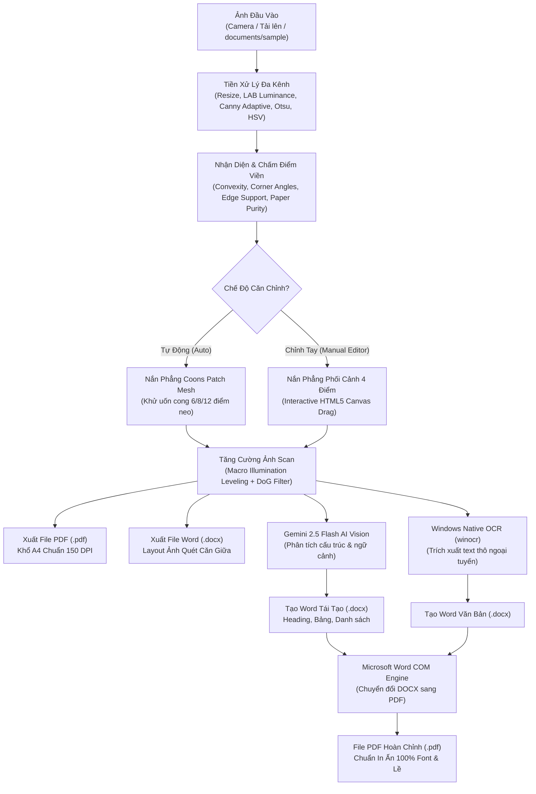

# 📄 Document Scanner & Converter Studio

Hệ thống quét tài liệu thông minh, nắn phẳng góc nghiêng (Perspective & Coons Patch Mesh Warp), nhận diện ký tự quang học (OCR) và chuyển đổi định dạng tài liệu đa năng được xây dựng trên nền tảng **Python**, **OpenCV**, **Streamlit** và **Google Gemini AI**.

Dự án cho phép chuyển đổi ảnh chụp tài liệu từ điện thoại, webcam hoặc tập tin tải lên thành bản scan phẳng, sạch nền, tương phản cao tương đương các ứng dụng quét chuyên nghiệp (CamScanner, Adobe Scan). Đồng thời, hệ thống tích hợp công nghệ AI Vision thế hệ mới (**Gemini 2.5 Flash**) giúp tái tạo văn bản gốc sang định dạng **Microsoft Word (.docx)** có đầy đủ cấu trúc (tiêu đề, bảng biểu, danh sách) và hỗ trợ chuyển đổi sang **PDF (.pdf)** giữ nguyên 100% định dạng.

🌐 **Demo trực tuyến (Cloud Deployment)**: [https://document-cute.streamlit.app/](https://document-cute.streamlit.app/)

---

## 🌟 Các Tính Năng Nổi Bật

1. **Nhận diện viền trang tự động đa điểm neo (4, 6, 8, 12 điểm)**:
   - Thuật toán phân tích đa kênh màu (LAB, HSV, Canny, Otsu) kết hợp hàm chấm điểm lồi (Convexity), góc trong ($60^\circ - 120^\circ$) và độ thuần khiết nền giấy (Paper Purity Score).
   - Tự động bám sát mép giấy bị cong võng hoặc bo tròn góc nhờ cơ chế bắn tia chuẩn tắc (Normal Ray-Casting) tại các trung điểm viền.
2. **Bộ chỉnh tay viền tài liệu tương tác trực tiếp (Interactive Quad Canvas Editor)**:
   - Tích hợp canvas HTML5/JavaScript hai chiều mượt mà ngay trên trình duyệt.
   - Kéo tự do 4 góc (chấm đỏ) hoặc dịch chuyển song song toàn bộ cạnh (chấm cam) với thấu kính phóng đại thời gian thực (Magnifier Loupe) và ràng buộc hình học lồi nghiêm ngặt (đường viền luôn thẳng tuyệt đối).
3. **Nắn phẳng phối cảnh & khử uốn cong (Perspective & Coons Patch Mesh Warp)**:
   - Áp dụng phép biến đổi phối cảnh 4 điểm (Homography) và lưới nội suy Coons Patch Mesh Warp khử hoàn toàn hiện tượng méo do góc chụp nghiêng hoặc trang sách bị gồ lên.
   - Nội suy Lanczos-4 duy trì độ sắc nét tối đa của các nét chữ viết tay và chi tiết nhỏ.
4. **Bộ lọc nâng cao chất lượng bản scan (Intelligent Document Enhancement)**:
   - **✨ Scan thông minh (Magic Color)**: Cân bằng chiếu sáng vĩ mô (Macro Illumination Leveling), khử sạch bóng râm, làm trắng tinh nền giấy ($255$) mà vẫn giữ nguyên màu mực tự nhiên.
   - **🖋️ Scan xám mịn (Magic Gray)**: Chống răng cưa nét chữ, phù hợp lưu trữ tài liệu in ấn văn bản hành chính.
   - **📄 Scan đen trắng (B&W High-Contrast)**: Thuật toán thích nghi Gaussian kết hợp lọc hình thái học hai pha, tối ưu hóa cho nhận diện OCR.
   - **🖼️ Màu nguyên bản nắn phẳng (Color Deskewed)**: Giữ nguyên dải màu ảnh gốc sau khi nắn thẳng.
5. **Đa dạng phương thức đầu vào (Input Modalities)**:
   - **Camera / Webcam trực tiếp**: Chụp tức thời trên giao diện web hoặc cửa sổ OpenCV preview full HD với phím tắt `SPACE`.
   - **Tải ảnh lên (Upload)**: Hỗ trợ đa dạng định dạng (`.jpg`, `.jpeg`, `.png`, `.webp`, `.bmp`).
   - **Ảnh mẫu có sẵn (Sample Dataset)**: Thử nghiệm nhanh với 5 mẫu tài liệu thực tế trong thư mục `documents/sample/`.
6. **Tái tạo tài liệu thông minh bằng AI (Gemini 2.5 Flash Vision DOCX Reconstruction)**:
   - AI đọc hiểu trực quan cấu trúc tài liệu từ ảnh scan.
   - Tái tạo thành file Word `.docx` chuẩn gồm tiêu đề các cấp (Heading 1/2/3), đoạn văn thụt lề, bảng biểu (Tables) có kẻ viền và đổ màu tiêu đề, danh sách (Bullet Lists) và mô tả sơ đồ/hình ảnh — **không phải chèn ảnh thô vào Word**.
7. **Trích xuất chữ OCR truyền thống**:
   - Hỗ trợ Windows Native OCR (`winocr`) ngoại tuyến, bảo mật và tốc độ cao.
   - Cơ chế fallback linh hoạt sang `easyocr` hoặc `pytesseract` cho tiếng Việt và tiếng Anh.
8. **Chuyển đổi Word (.docx) sang PDF (.pdf) 1-click**:
   - Tận dụng Microsoft Word COM Automation trên Windows để xuất PDF đạt độ tương thích 100% về font chữ, căn lề và định dạng trang in ấn chuẩn A4.

---

## 🏗️ Kiến Trúc Hệ Thống & Quy Trình Xử Lý



---

## 📁 Cấu Trúc Thư Mục Dự Án

```
document-scanner/
├── app.py                      # Ứng dụng Web UI tương tác Streamlit
├── run_app.bat                 # Script chạy nhanh 1-click trên Windows
├── requirements.txt            # Danh sách thư viện Python cần cài đặt
├── README.md                   # Tài liệu hướng dẫn sử dụng tiếng Việt
├── .env                        # File cấu hình biến môi trường (Gemini API Key)
├── .gitignore                  # Cấu hình bỏ qua các file tạm/cache
├── documents/
│   └── sample/                 # 5 ảnh mẫu kiểm thử nghiệm thực tế
│       ├── sample1.jpg         # Tài liệu cơ bản (base document)
│       ├── sample2.jpg         # Chụp nghiêng góc phối cảnh mạnh (diagonal)
│       ├── sample3.jpg         # Mẫu khó: giấy viền mờ / phức tạp (fail-case ban đầu)
│       ├── sample4.jpg         # Vở kẻ ô uốn cong thực tế từ GNHK dataset
│       └── sample5.jpg         # Chụp dưới ánh sáng phức tạp / bóng đỏ
├── outputs/                    # Thư mục chứa kết quả xuất scan, debug, logs
│   ├── .gitkeep
│   └── reference/
│       └── debug/              # Artifacts trực quan và log đánh giá benchmark
├── scripts/                    # Các kịch bản chạy dòng lệnh (CLI Tools)
│   ├── __init__.py
│   ├── capture_scan.py         # Quét trực tiếp từ webcam qua phím SPACE
│   ├── convert_docx_to_pdf.py  # Chuyển đổi DOCX sang PDF độc lập qua COM
│   ├── multi_img_test.py       # Đánh giá hàng loạt (batch) và ghi log CSV
│   ├── ocr_test.py             # Trích xuất OCR text ra file Word (.docx)
│   └── single_img_test.py      # Quét 1 ảnh đơn lẻ và xuất PDF/Word
└── src/                        # Các module xử lý thuật toán cốt lõi
    ├── __init__.py
    ├── ai_docx_builder.py      # Bộ dựng tài liệu Word cấu trúc từ JSON AI
    ├── camera.py               # Quản lý thiết bị webcam và hiển thị preview
    ├── converter.py            # Tự động hóa Microsoft Word COM trên Windows
    ├── detect_page.py          # Thuật toán nhận diện viền trang và chấm điểm
    ├── export.py               # Xuất PDF và Word A4 từ danh sách ảnh
    ├── gemini_ocr.py           # Tích hợp Google Gemini 2.5 Flash Vision API
    ├── geometry.py             # Tính toán giao điểm, kiểm tra tính lồi, dịch cạnh
    ├── io_handling.py          # Đọc/ghi ảnh và tạo thư mục an toàn
    ├── ocr_engine.py           # Động cơ OCR Windows / EasyOCR / Tesseract
    ├── preprocess.py           # Chuẩn hóa kích thước, lọc sáng CLAHE, Canny
    ├── quad_editor.py          # Cầu nối component Streamlit Custom Quad Editor
    ├── thresholding.py         # Lọc Magic Color, Magic Gray, Adaptive B&W
    ├── transform.py            # Biến đổi phối cảnh & lưới Coons Patch Mesh
    └── components/
        └── quad_editor/
            └── index.html      # Mã nguồn HTML5 Canvas chỉnh tay tương tác
```

---

## ⚙️ Môi Trường & Yêu Cầu Hệ Thống

### 1. Yêu Cầu Phần Cứng & Hệ Điều Hành
- **Hệ điều hành**: Windows 10 / Windows 11 (64-bit) — *Bắt buộc đối với tính năng Windows Native OCR (`winocr`) và chuyển đổi file Word qua COM Automation*.
- **Python**: Khuyến nghị phiên bản **Python 3.10** hoặc **Python 3.11**.
- **Microsoft Office Word**: Đã cài đặt trên máy (để kích hoạt tính năng chuyển đổi file DOCX sang PDF qua COM).
- **Webcam / Camera USB**: Tùy chọn (dành cho tính năng chụp ảnh scan trực tiếp).
- **Kết nối Internet**: Cần thiết khi sử dụng tính năng AI Tái Tạo Văn Bản qua **Gemini 2.5 Flash API**.

### 2. Biến Môi Trường (API Key)
Để kích hoạt tính năng AI Vision phân tích tài liệu thông minh:
1. Đăng ký lấy API Key miễn phí tại [Google AI Studio](https://aistudio.google.com/app/apikey).
2. Tạo file `.env` tại thư mục gốc của dự án với nội dung:
   ```env
   GEMINI_API_KEY=your_gemini_api_key_here
   ```
   *(Hoặc bạn có thể nhập trực tiếp API Key vào thanh Sidebar trên giao diện Web UI).*

---

## 📦 Hướng Dẫn Cài Đặt

### Bước 1: Tải mã nguồn về máy
```bash
git clone https://github.com/Vietcute0210/document-scanner.git
cd document-scanner
```

### Bước 2: Tạo và kích hoạt môi trường ảo Python
Sử dụng môi trường ảo giúp cô lập các thư viện:
```bash
# Tạo môi trường ảo
python -m venv .venv

# Kích hoạt môi trường ảo trên Windows PowerShell:
.venv\Scripts\Activate.ps1

# Hoặc trên Command Prompt (cmd.exe):
.venv\Scripts\activate.bat
```

### Bước 3: Cài đặt các thư viện phụ thuộc
```bash
pip install --upgrade pip
pip install -r requirements.txt
```

---

## 🚀 Hướng Dẫn Chạy Ứng Dụng (Lệnh Chạy)

### Cách 1: Khởi động nhanh 1-Click trên Windows
Nhấp đúp chuột vào file **`run_app.bat`** tại thư mục gốc. Trình duyệt mặc định sẽ tự động mở trang web ứng dụng tại địa chỉ: `http://localhost:8501`.

### Cách 2: Khởi động qua Terminal (Web UI)
Kích hoạt môi trường ảo và chạy lệnh:
```bash
streamlit run app.py
```

### Cách 3: Sử dụng các công cụ dòng lệnh (CLI Tools)

#### 1. Quét một ảnh đơn lẻ và xuất PDF / Word:
```bash
python -m scripts.single_img_test --img documents/sample/sample1.jpg --outdir outputs/my_scan --pdf --docx
```
- `--img`: Đường dẫn tới ảnh cần quét *(bắt buộc)*.
- `--outdir`: Thư mục lưu kết quả *(mặc định: outputs/debug/run_one)*.
- `--max-dim`: Kích thước cạnh dài tối đa khi nhận diện *(mặc định: 1200)*.
- `--clahe`: Bật cân bằng sáng CLAHE khi ảnh bị sấp bóng tối.
- `--pdf`: Tự động tạo file `scanned_doc.pdf`.
- `--docx`: Tự động tạo file `scanned_doc.docx`.

#### 2. Mở Webcam chụp ảnh và quét tài liệu trực tiếp:
```bash
python -m scripts.capture_scan --outdir outputs/camera_scans --camera 0
```
- Nhấn phím `SPACE` (cách) để chụp và nắn phẳng ngay lập tức.
- Nhấn `ESC` hoặc `Q` để thoát preview.

#### 3. Trích xuất chữ bằng OCR ra file Word (.docx) chỉnh sửa được:
```bash
python -m scripts.ocr_test --img documents/sample/sample1.jpg --out outputs/my_scan/extracted.docx --lang vi
```
- `--lang`: Ngôn ngữ nhận diện (`vi` cho Tiếng Việt, `en` cho Tiếng Anh).

#### 4. Chuyển đổi file DOCX sang PDF bằng Word COM:
```bash
python -m scripts.convert_docx_to_pdf --docx outputs/my_scan/scanned_doc.docx --out outputs/my_scan/final.pdf
```

#### 5. Đánh giá chất lượng hàng loạt trên cả thư mục ảnh (Batch Evaluation):
```bash
python -m scripts.multi_img_test --input documents/sample --outdir outputs/batch_eval --pdf --docx
```
- Script tự động tính toán tỷ lệ nhận diện thành công, điểm tin cậy trung bình, tỷ lệ nét mực (`fg_ratio`), số lượng thành phần liên thông (`num_cc`) và lưu vào file `outputs/batch_eval/detection_log.csv`.

---

## 📊 Đầu Ra Mong Đợi (Expected Outputs)

Sau khi xử lý tài liệu, hệ thống xuất ra các định dạng chuẩn hóa sau:

1. **Bản scan hình ảnh (`.png`)**:
   - Kích thước chuẩn hóa ($>1600$ px chiều rộng) với tỷ lệ gốc được bảo toàn.
   - Nền trắng tinh khiết $255$, nét mực nổi khối, rõ nét, không bị răng cưa hay vỡ hạt.
2. **Tập tin PDF chuẩn A4 (`.pdf`)**:
   - Độ phân giải in ấn 150 DPI tiêu chuẩn, căn giữa trang hoàn hảo, sẵn sàng cho việc in ấn hoặc đính kèm email hành chính.
3. **Tập tin Word nhúng ảnh (`.docx`)**:
   - Trang Word A4 lề chuẩn $0.5$ inch, nhúng toàn bộ ảnh scan vừa vặn khung in.
4. **Tập tin Word AI tái tạo cấu trúc (`.docx`)**:
   - Chứa văn bản thật có thể bôi đen, sao chép và chỉnh sửa.
   - Tiêu đề Heading phân cấp rõ ràng (font chữ Calibri/Times New Roman).
   - Bảng biểu có ô, cột kẻ lưới (`Table Grid`) chuẩn xác, dòng header được bôi đậm và tô màu nền.
   - Danh sách gạch đầu dòng căn lề chuẩn Word.
5. **Tập tin PDF chuyển đổi từ Word COM**:
   - Giữ nguyên 100% định dạng, phông chữ Unicode, khoảng cách dòng và bảng biểu của tài liệu Word gốc.

---

## 📂 Dữ Liệu Thử Nghiệm & Đường Dẫn Tải Dữ Liệu

### 1. Thư mục ảnh mẫu đi kèm (`documents/sample/`)
Hệ thống tích hợp sẵn 5 mẫu ảnh đại diện cho các kịch bản khó trong thực tế:
- **`sample1.jpg`** (`1.45 MB`): Tài liệu in tiêu chuẩn, nền bàn gỗ phẳng.
- **`sample2.jpg`** (`1.72 MB`): Tài liệu chụp chéo ở góc nghiêng $45^\circ$, độ biến dạng phối cảnh lớn.
- **`sample3.jpg`** (`130 KB`): Vở viết tay bo góc tròn, viền mờ sát nền (thử thách tách biên).
- **`sample4.jpg`** (`4.24 MB`): Vở viết tay khổ lớn với mép giấy bị uốn cong hình lòng máng.
- **`sample5.jpg`** (`1.58 MB`): Tài liệu chụp dưới ánh đèn vàng/đỏ cường độ không đều và bóng đổ phức tạp.

### 2. Tập dữ liệu quy chuẩn GNHK Dataset
Dự án được đối chuẩn và thử nghiệm trên tập dữ liệu chuẩn hóa quốc tế:
- **Tên dataset**: *GNHK: A Dataset for English Handwriting in the Wild* (ICDAR 2021).
- **Tác giả**: Lee, A. W. C., Chung, J., & Lee, M. (GoodNotes Research).
- **Đường dẫn trang chủ**: [https://www.goodnotes.com/gnhk/](https://www.goodnotes.com/gnhk/)
- **Kho lưu trữ GitHub tải dữ liệu**: [https://github.com/GoodNotes/GNHK-dataset](https://github.com/GoodNotes/GNHK-dataset)

---

## 🔬 Thuật Toán Cốt Lõi & Đóng Góp Kỹ Thuật

### 1. Nhận diện viền tài liệu thông minh (`src/detect_page.py`)
- **Phân đoạn đa kênh**: Kết hợp mặt nạ độ sáng không gian màu CIE LAB, biến đổi Otsu cục bộ, dải màu HSV và lọc Canny thích nghi theo trung vị ảnh.
- **Hàm chấm điểm đa tiêu chí**:
  $$Score = 0.22 \cdot S_{area} + 0.24 \cdot S_{contrast} + 0.26 \cdot S_{purity} + 0.14 \cdot S_{edge} + 0.08 \cdot S_{angle} + 0.06 \cdot S_{balance} - P_{border}$$
  Giúp loại bỏ hoàn toàn các viền giả bên trong trang giấy (như bảng biểu, dòng kẻ vở) hoặc các vật thể ngoại lai nằm sát mép (bàn phím laptop, bàn làm việc).

### 2. Nắn phẳng Coons Patch Mesh Warp (`src/transform.py`)
- Thay vì chỉ sử dụng ma trận biến đổi phối cảnh $3 \times 3$ thông thường (chỉ làm việc với 4 góc thẳng), thuật toán xây dựng lưới nội suy Coons Patch trên $65 \times 65$ mắt lưới:
  $$P(u, v) = P_{base}(u, v) + (1-v)\Delta_{top}(u) + v\Delta_{bottom}(u) + (1-u)\Delta_{left}(v) + u\Delta_{right}(v)$$
  Khử triệt để hiện tượng dòng chữ bị uốn lượn do trang giấy bị gập hoặc uốn cong.

### 3. Tăng cường ảnh Magic Color (`src/thresholding.py`)
- Mô phỏng cơ chế ức chế bên (Lateral Inhibition) của võng mạc kết hợp lọc bề mặt chiếu sáng vĩ mô (Macro Illumination Leveling percentile 75th).
- Nâng độ đậm nét chữ bằng hàm đường cong nén phi tuyến tính (Rational Reinhard Tone Curve):
  $$I_{ink} = \frac{boost \cdot 1.30 \cdot D_{total}}{1.0 + boost \cdot 0.75 \cdot D_{total}}$$
  Đảm bảo chữ viết tay mảnh hay chữ in mờ đều trở nên đậm nét, trong khi nền giấy đạt độ trắng tuyệt đối $255$.

---

## 📝 Bản Quyền & Giấy Phép (License)

Dự án được phát hành mã nguồn mở dưới giấy phép **MIT License**. Mọi đóng góp, báo lỗi (issue) và yêu cầu kéo (pull request) đều được hoan nghênh.
